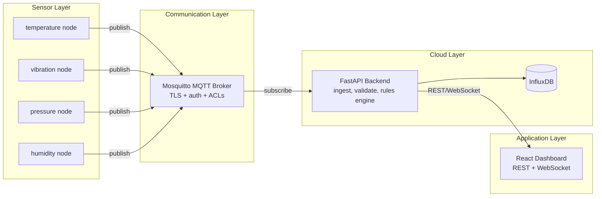

# IIoT Smart Factory Monitoring System

A complete local prototype of an Industrial IoT monitoring stack: virtual
sensor nodes publish over an authenticated, TLS-encrypted MQTT broker, a
FastAPI backend ingests and stores the data with a threshold-based alerting
engine, and a React dashboard visualizes everything live.

No physical hardware required — sensors are simulated with realistic
noise, drift, and on-demand anomaly injection.

## Architecture



See [docs/ARCHITECTURE.md](docs/ARCHITECTURE.md) for the full data-flow
explanation and [docs/SECURITY.md](docs/SECURITY.md) for the security model.

## Prerequisites

- Docker Desktop (or Docker Engine + Compose v2)
- Nothing else — sensors, broker, backend, database, and dashboard all run
  in containers.

## Setup

1. **Generate TLS certificates** for the broker (self-signed, for local dev):

   ```bash
   cd broker
   ./generate-certs.sh
   cd ..
   ```

   This writes `broker/certs/ca.crt`, `server.crt`, `server.key`. For a real
   deployment, replace `server.crt`/`server.key` with certs from a real CA
   and distribute that CA's cert as `ca.crt` to clients instead.

2. **Copy the environment file** and adjust credentials/secrets if you want:

   ```bash
   cp .env.example .env
   ```

3. **Start the stack**:

   ```bash
   docker compose up --build
   ```

   This brings up, in order: an init job that creates the MQTT password
   file, the Mosquitto broker, InfluxDB (auto-provisioned with an org/bucket
   via env vars), the FastAPI backend, the dashboard, and four sensor
   simulators (temperature, vibration, pressure, humidity) that start
   publishing every 5 seconds once the broker is healthy.

4. **Open the dashboard**: http://localhost:8080

   Log in with the demo credentials (from `.env`, defaults to
   `admin` / `admin123`).

## Demo script

1. Run `docker compose up --build` and wait for all services to report healthy
   (`docker compose ps`).
2. Open http://localhost:8080 and log in.
3. Watch the **Live Sensor Readings** panel update every 5 seconds and the
   **Historical Trend** chart accumulate data for the selected node.
4. Click **Trigger anomaly** next to any sensor. This publishes a control
   message through the backend to that sensor's MQTT control topic, causing
   it to inject a sudden spike on its next reading.
5. Within a few seconds the spike breaches a threshold rule (see
   `backend/rules.yaml`), the backend raises an alert, stores it in
   InfluxDB, and pushes it over the WebSocket — watch it appear instantly in
   the **Active Alerts** panel.
6. Check the **status pills** in the top bar to see MQTT/database
   connectivity and the live-feed WebSocket state.

## Project structure

```
sensor-nodes/   Python virtual sensor simulators (paho-mqtt)
broker/         Mosquitto config, TLS certs, ACLs
backend/        FastAPI ingestion, storage, rules engine, REST/WebSocket API
dashboard/      React (Vite) frontend
docs/           Architecture, security, and setup documentation
```

## Configuration

- `sensor-nodes/config.yaml` — node ids, topics, baselines, noise/drift
  parameters, publish interval.
- `backend/rules.yaml` — alert thresholds per sensor type.
- `broker/config/mosquitto.conf` / `acl.conf` — broker auth and topic ACLs.
- `.env` (root) — shared credentials/secrets consumed by `docker-compose.yml`.

## Running components individually (without Docker)

Each of `sensor-nodes/`, `backend/`, and `dashboard/` has its own
`requirements.txt` / `package.json` and can be run locally against a broker
and database you provide — see the `.env.example` in each directory for the
variables it expects.
